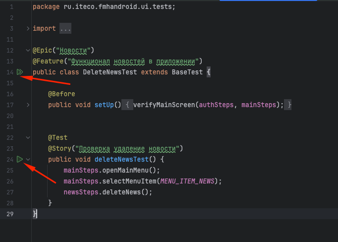

# Приложение «Мобильный хоспис»

## Запуск тестов
# Через Android Studio



# Через команду Gradle:

```bash
./gradlew connectedAndroidTest
```

## Генерация отчета Allure с помощью команды:

```bash
allure serve build/allure-results
```
